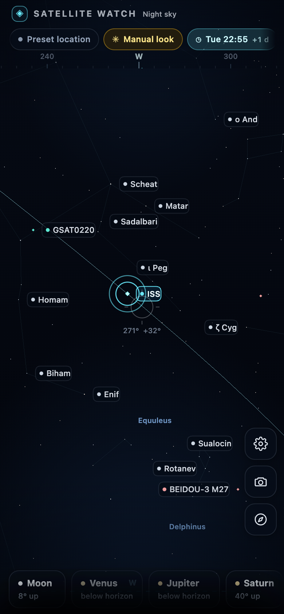
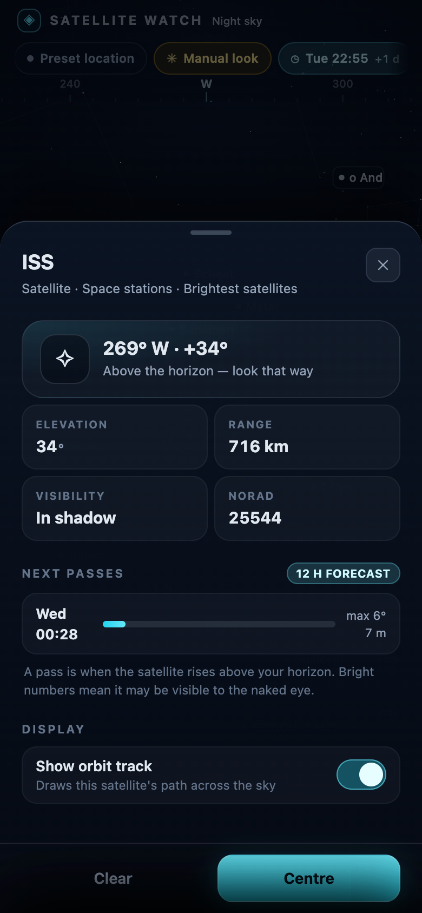
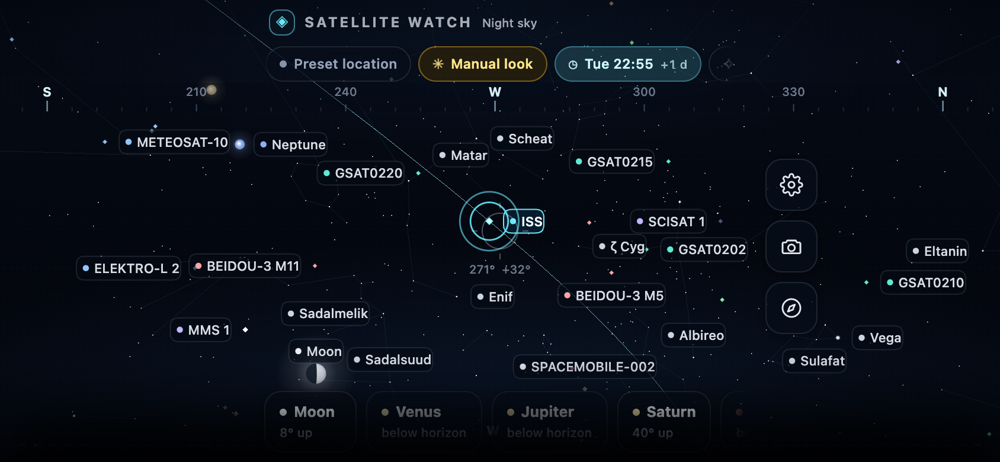
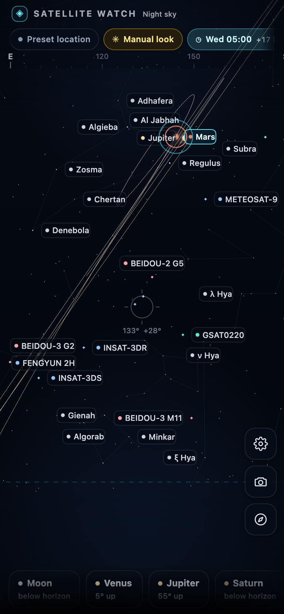
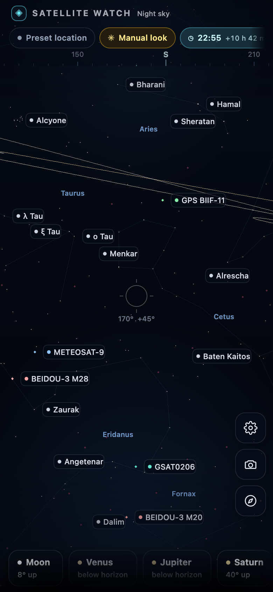
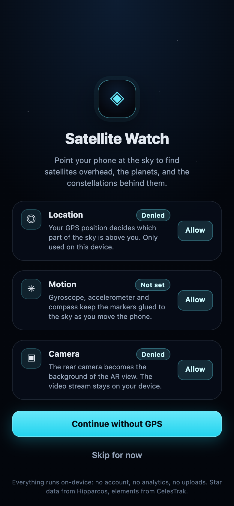
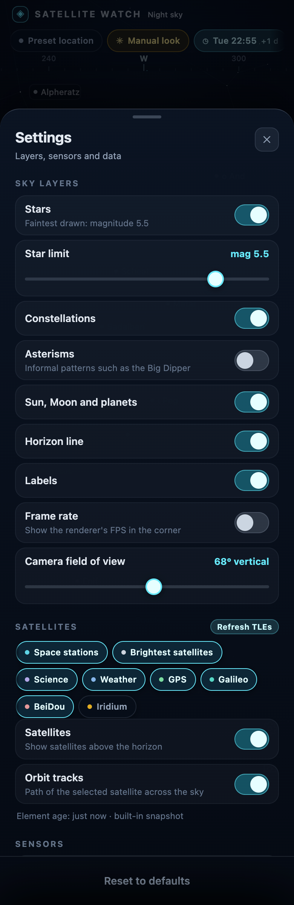

# Satellite Watch — mobile AR sky

A mobile-first single-page app that turns your phone into a window on the sky. GPS fixes your
position, the gyroscope/accelerometer/compass keep the overlay glued to the real world, and the
rear camera becomes the background: satellites (with their orbital tracks), the Sun, Moon and
planets, bright stars and constellation figures all appear where they actually are.

No account, no backend, no tracking. It runs entirely on the device and works offline once loaded.

**Live:** <https://seekahead.eu/sky/> (self-hosted Caddy) · <https://david-batranu.github.io/satellite-watch/> (GitHub Pages mirror)
— both installable as a PWA. Motion, GPS and camera only work over HTTPS on a real phone; on a
desktop the app falls back to drag-to-look.

<p align="center">
  
  &nbsp;
  
  &nbsp;
  
</p>
<p align="center">
  
  &nbsp;
  
  &nbsp;
  
  &nbsp;
  
</p>

## What it does

**Live AR sky**

- **Satellites** — ~480 tracked objects (space stations, the brightest satellites, weather,
  science, GPS/Galileo/BeiDou, Iridium) propagated with SGP4 in a Web Worker, colour-coded by
  category, dimmed when they are inside the Earth's shadow. An optional **Starlink** layer adds
  the full ~10,600-object constellation; it downloads on first use (not part of the initial
  install), caches on the device, and renders as dense markers without flooding the screen with
  labels.
- **Orbit tracks** — selecting a satellite draws its path across your local sky for the next
  hour and a quarter, fading from past to future.
- **Pass predictions** — rise, culmination and set for the next 12 hours, with maximum elevation,
  duration and whether the pass is sunlit.
- **Sun, Moon and planets** — topocentric positions with atmospheric refraction, the Moon rendered
  with its actual phase, plus next rise/set and the constellation each body is in.
- **Stars and constellations** — 5,044 Hipparcos stars to magnitude 6, coloured by B−V, with the
  88 IAU constellation figures and named asterisms, precessed to the current epoch.
- **Planet orbits** — each planet's apparent path against the stars over the next year, plus the
  Sun's path (the ecliptic). The curves show how planets move through the zodiac, including the
  retrograde loops of Mercury, Venus and Mars; the selected body's path is drawn brighter.
  Toggle in Settings → Sky layers.
- **Calibration** — heading, pitch, field of view and sensor-status diagnostics, because phone
  compasses are never perfectly aligned.
- **Graceful degradation** — no GPS: manual coordinates or city presets. No compass: gyro fusion or
  drag-to-look. No camera: a night-sky background. No motion at all: manual panning.
- **Offline-ready PWA** — star data and a TLE snapshot are bundled; the service worker precaches
  everything. Elements can be refreshed from CelesTrak on demand.
- **Time travel** — shift the sky clock up to ±48 h to preview passes (great for planning).

## Quick start

```bash
npm install          # uses the repo-local npm cache (.npmrc), no sudo needed
npm run dev          # http://localhost:5173
npm run build        # typecheck + production build into dist/
npm run preview      # serve the production build
npm test             # 98 unit tests
npm run typecheck
npm run deploy:pages # publish the GitHub Pages artifact branch
npm run deploy:sky   # publish the /srv/caddy/sky artifact branch
```

Requirements: Node 22+ (developed on Node 26). `npm run data:all` regenerates the bundled
catalogues; `npm run icons` regenerates the PWA icons.

### On a real phone

Motion sensors and the camera require a **secure context**. `http://<lan-ip>:5173` will load but
the sensors/camera stay unavailable, so use one of these:

1. **Trusted HTTPS on the LAN** — `npm run dev:https`, then open `https://<your-ip>:5173` and accept
   the self-signed certificate. (`@vitejs/plugin-basic-ssl`.)
2. **Port forwarding** — Android: `chrome://inspect/#devices` → Port forwarding → `localhost:5173`.
3. **A tunnel** — cloudflared/ngrok pointed at the dev server or at `npm run preview`.

iOS asks for **Motion & Orientation** and **Camera** permission on the first tap of each "Allow"
button in the onboarding screen — Safari requires a user gesture, which is why the app never
auto-requests them.

## Demo / screenshot mode

The app can be driven deterministically from the URL, which is how the screenshots above were
produced (headless Chrome + SwiftShader via `npm run shot`):

```
?demo=1&lat=44.43&lon=26.10&az=271&alt=32
&time=2026-11-17T20:55:00Z
&target=sat:25544&sheet=detail
&fov=68&camera=0&ui=1
```

| Parameter | Meaning |
|---|---|
| `demo=1` | Manual-look mode with a fixed observer; skips onboarding |
| `lat`, `lon`, `az`, `alt` | Observer position and initial gaze (degrees) |
| `time` | ISO timestamp for the sky clock (offset from now, clamped to ±48 h) |
| `target` | Pre-select a target: `sat:25544`, `body:moon`, `star:123`, `con:Ori` |
| `sheet` | Open `detail`, `settings`, `location`, `calibrate` or `credits` |
| `fov` | Vertical field of view in degrees |
| `camera=1` | Try the camera (off by default in demo mode) |
| `ui=0` | Hide the DOM chrome (clean screenshots) |

`npm run shot <url> <out.png> [width] [height] [waitMs]` runs headless Chrome, prints page errors
and saves a PNG — useful for visual regressions and layout checks in portrait and landscape.

## How it works

```
GPS + motion sensors ─► sensor fusion ─► camera quaternion
                                            │
                            ┌───────────────┴────────────────┐
                            ▼                                ▼
                 astronomy-engine (planets)        SGP4 worker (satellites)
                            │                                │
                 star catalogue + precession     az/el/range/sunlit batched at 2 Hz
                            └───────────────┬────────────────┘
                                            ▼
                         three.js sky dome  +  canvas-2D HUD (labels, ribbon, arrows)
```

**Coordinate pipeline.** Stars and constellation vertices are stored in J2000 equatorial
coordinates, precessed to the equator of date with astronomy-engine's `Rotation_EQJ_EQD`, and
rotated into the local sky with a single matrix built from local apparent sidereal time and the
observer's latitude. Atmospheric refraction (Bennett) is applied per point. Satellites are
propagated in TEME by satellite.js, rotated to Earth-fixed with GMST, then to the observer's ENU
frame. Everything ends up in a three.js Y-up world where **+X = East, +Y = Up, +Z = South**, and
the camera quaternion comes from the W3C device-orientation model.

**Orientation.** Only **one** orientation stream is used: `deviceorientationabsolute` is preferred,
and the relative `deviceorientation` stream is suppressed while absolute data flows. (Chrome on
Android fires both from the same sensor with different yaw origins; feeding both made the camera
chase two headings — a 30° heading error and a visibly trembling sky.) On iOS, where alpha is
relative, the app measures the offset against `webkitCompassHeading` whenever the phone is held
flat and tracks it over time.

A complementary filter (`src/sensors/imuFusion.ts`) fuses that with raw gyroscope and
accelerometer samples. Heading and tilt are damped **separately** with dt-aware time constants
(`src/sensors/quatFilters.ts`, swing–twist decomposition), and the damping adapts to the measured
rotation speed: heavy while the phone is still, light while you turn. The gyro is only integrated
above a noise dead band, and the accelerometer is only used as a slow tilt reference when OS
orientation events go quiet — so resting sensor noise never reaches the sky, while 10–20 Hz sensor
events still look smooth at 60 fps. `Camera smoothing` in Settings scales the time constants.

**Rendering.** one WebGL draw pass for stars, constellation lines, satellites, the selected
satellite's orbit track and the planet orbit lines,
plus a 2D canvas for labels, the heading ribbon, the Sun/Moon/planet discs, the reticle and the
off-screen target arrow. Labels are collision-avoided against each other, the DOM chrome and the
reticle. Points are drawn through small custom shaders with per-vertex size and colour, so a
magnitude-6 star is a fraction of a pixel while Sirius is a glowing dot.

**Performance.** the initial bundle is ~85 KB gzip; the engine (three.js, astronomy-engine,
satellite.js) is a lazy chunk (~152 KB gzip) loaded right after first paint. Bulk SGP4 runs in a
Web Worker; the main thread only writes typed-array buffers (no per-frame allocation). Pixel ratio
is capped at 2 and the render loop stops when the tab is hidden.

### Project layout

```
src/
  engine/      skyEngine.ts   integration: frame loop, model, interaction, camera
               targets.ts     namespaced target ids
  sensors/     orientationMath.ts, imuFusion.ts, sensorManager.ts, geolocation.ts
  astro/       frame.ts (frames, precession, refraction), skyBodies.ts, starCatalog.ts, planetPasses.ts
  satellites/  tle.ts, propagation.ts, passes.ts, catalog.ts, worker.ts, groups.ts
  render/      skyRenderer.ts, labelLayer.ts, projection.ts, shaders.ts
  ui/          ARView, StatusBar, QuickTargets, sheets, controls, icons
  state/       store.ts (zustand + persistence), settings.ts, engineContext.ts
  lib/         enu.ts, angles.ts, starColor.ts, format.ts, storage.ts, demo.ts
  data/        (generated at build time — see public/data)
scripts/       fetch-tle.mjs, fetch-catalogs.mjs, make_icons.py, screenshot.mjs
tests/         98 unit tests (vitest, node environment)
public/data/   stars.json, constellations.json, asterisms.json, tle-snapshot.json
```

## Data

| Dataset | Source | Refresh |
|---|---|---|
| TLEs (~480 sats) | [CelesTrak](https://celestrak.org) `gp.php` | bundled snapshot + on-demand/auto refresh in the browser (CORS-enabled), cached in IndexedDB |
| Starlink (~10,600 sats) | [CelesTrak](https://celestrak.org) `gp.php?GROUP=starlink` | separate on-demand file (not precached), cached in IndexedDB after first load |
| Stars, constellations, asterisms | [d3-celestial](https://github.com/ofrohn/d3-celestial) (Hipparcos, IAU figures) | `npm run data:catalogs` |
| Sun/Moon/planets | [astronomy-engine](https://github.com/cosinekitty/astronomy) at runtime | — |

`npm run data:tle` re-fetches the snapshot (and the Starlink file) from CelesTrak, with TLE
checksum validation. CelesTrak throttles the large group queries; if the Starlink request returns
HTTP 403, pass a previously downloaded TLE file instead:

```bash
STARLINK_TLE_FILE=/path/to/starlink.tle TLE_SKIP_BASE=1 npm run data:tle
```

The app
also refreshes elements itself when the cached copy is older than ~1.5 days, and the Settings
sheet has an explicit **Refresh TLEs** button.

## Accuracy and limitations

- **Satellites**: SGP4 on the bundled elements matches an independent WGS84 implementation to
  ~15 m at the reference epoch (unit-tested against `python-sgp4`). Error grows with element age —
  roughly 1–3 km per day of along-track drift for LEO, which is invisible in a consumer sky view.
  Refresh the elements for critical use.
- **Stars/planets**: agreement with astronomy-engine's `Horizon()` is better than 0.01° (tested),
  including precession and refraction.
- **Sensor alignment** is the dominant real-world error: phone compasses drift by degrees. The
  calibration sheet exists for this reason, and `manualLook` gives a deterministic fallback.
- **Orientation jitter** is filtered, not eliminated: simulated resting noise (σ 1.5° heading)
  produces <0.2° of frame-to-frame camera movement, but a noisy magnetometer near metal can still
  wobble slowly. Raise `Camera smoothing` if the view feels restless; it trades steadiness for lag
  when turning.
- The camera field of view cannot be read from the web platform; 68° vertical is a good default
  for phone main cameras and is adjustable (pinch or the calibration sheet).
- Sun/Moon/planet discs use a minimum on-screen size so they stay tappable; they are not rendered
  to scale at short focal lengths.
- Not included (yet): deep-sky objects, a ground-track map, pass notifications, sharing.

## Testing

```bash
npm test        # vitest: 98 tests, ~0.3 s
npm run shot "http://127.0.0.1:8932/?demo=1&..." /tmp/shot.png 390 844
```

The suite covers the parts where being wrong is invisible but embarrassing: azimuth/altitude
conventions, WGS84 geodetic→ECEF, the device-orientation quaternion (cross-checked against
three.js's reference implementation with known geometric cases), the complementary filter,
precession/LST/refraction against `Horizon()`, SGP4 against `python-sgp4`, pass prediction
ordering, star catalogue integrity, projection against three.js, settings sanitisation and the
label/formatting helpers.

## Deployment

The build is fully static (`dist/`): serve it over HTTPS with `.json` as `application/json` and
compression enabled. `PAGES_BASE` sets the path prefix the build assumes, because Vite inlines it
into asset URLs, the service-worker scope and the web-app manifest.

Two deployments are wired up, both from static artifact branches so the target host needs no
Node.js or build step:

| Target | URL | Branch | Base |
|---|---|---|---|
| Home server (Caddy) | <https://seekahead.eu/sky/> | `deploy-sky` | `/sky/` |
| GitHub Pages | <https://david-batranu.github.io/satellite-watch/> | `gh-pages` | `/satellite-watch/` |

```bash
npm run deploy:pages    # build → force-push dist/ to gh-pages (Pages rebuilds automatically)
npm run deploy:sky      # build → force-push dist/ to deploy-sky (then update the server checkout)
```

Each artifact branch carries a `deploy-info.txt` recording the source commit, build base and
timestamp, so a deployed directory can always be traced back to a commit.

### seekahead.eu/sky — Caddy on `copyleft`

Caddy runs in Docker from `/srv/caddy/docker-compose.yml`, alongside the solar app. The deployment
is a plain git checkout, mirroring how `/srv/caddy/solar-atlas` is deployed:

```
/srv/caddy/
  Caddyfile            # seekahead.eu vhost: /solar/, /sky/, /sunlight/
  docker-compose.yml   # mounts ./sky → /srv/sky:ro
  solar-atlas/         # git checkout of david-batranu/solar-atlas (main)
  sky/                 # git checkout of david-batranu/satellite-watch (deploy-sky)
```

Caddy serves it with the same hardened static-file block as the solar app (`.git` hidden and 404'd):

```caddyfile
redir /sky /sky/ 308

handle_path /sky/* {
    @git path_regexp ^/\.git($|/)
    respond @git 404

    root * /srv/sky
    file_server {
        hide .git
    }
}
```

Redeploy after `npm run deploy:sky` — no config reload needed, Caddy serves the checkout directly:

```bash
git -C /srv/caddy/sky fetch --depth 1 origin deploy-sky
git -C /srv/caddy/sky reset --hard FETCH_HEAD
```

The host has no Node.js, which is why the build happens locally and only the artifact is checked
out. Adding a new mount (as when `/sky` was first introduced) is the only case that needs
`docker compose up -d` to recreate the Caddy container; validate first with
`docker compose config -q` and `caddy validate --config /etc/caddy/Caddyfile --adapter caddyfile`.

### GitHub Pages

Served from the **`gh-pages`** branch (repo → Settings → Pages → *Deploy from a branch* →
`gh-pages` / `/`). This deliberately avoids a GitHub Actions workflow: the CLI token used for
publishing has `repo` scope but not `workflow`, so pushing `.github/workflows/*` is rejected.
`npm run deploy:pages` is the one-command replacement for CI-on-push.

`npm run preview` is enough for a local check. The app is installable to the home screen (PWA
manifest + maskable icons) and launches full-screen.

## Privacy

Location, camera frames and motion readings are processed on the device and never uploaded. The
only network requests are: the static app assets, the star/constellation JSON, and (optionally)
CelesTrak TLE refreshes. There is no analytics, no account and no third-party script.

## Credits

- **CelesTrak** (Dr T. S. Kelso) — two-line elements.
- **d3-celestial** (Olaf Frohn) — Hipparcos star catalogue and IAU constellation figures.
- **astronomy-engine** (Don Cross) — Sun, Moon and planet positions, frames, rise/set.
- **satellite.js** — SGP4/SDP4 propagation.
- **three.js** — WebGL sky rendering.
- Built with React, TypeScript, Vite and Zustand.
